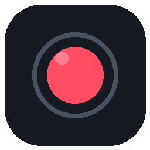
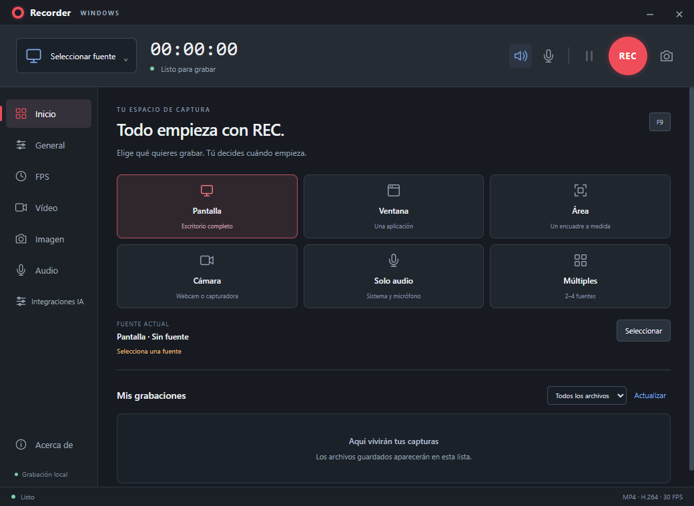
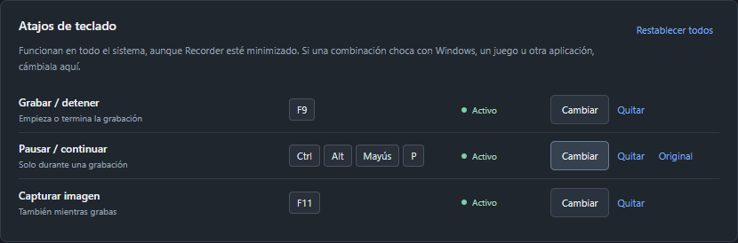
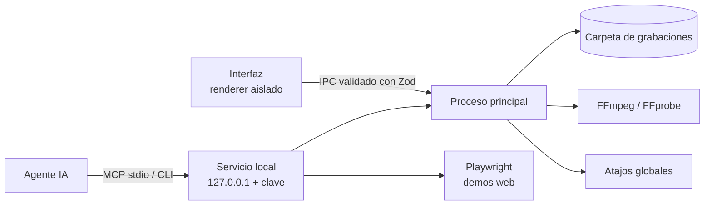

<div align="center">



# Recorder

**Grabador de pantalla, cámara y audio para Windows. Local, sin cuentas y controlable por agentes de IA.**




</div>

---

Recorder es un estudio de captura de escritorio en español. Graba pantallas, ventanas, áreas, cámaras y audio; exporta a MP4, MKV, AVI, WebM, MP3 o WAV; y guarda todo en tu equipo, sin telemetría ni subidas.

Además expone **22 herramientas por MCP y CLI** para que un agente de IA (Claude Code, Codex u otro cliente MCP) grabe, pause, haga capturas, genere demos web automatizadas, narre con voces locales y monte el vídeo final, sin recurrir a *computer use*.

> **Estado del proyecto.** Es una versión temprana, pero ya plenamente funcional y cubierta por pruebas automáticas. Hay mucho margen para pulir y ampliar: las contribuciones son bienvenidas.

## Contenido

- [Características](#características)
- [Instalación](#instalación)
- [Uso](#uso)
- [Integración con agentes de IA](#integración-con-agentes-de-ia)
- [Desarrollo](#desarrollo)
- [Arquitectura](#arquitectura)
- [Limitaciones conocidas](#limitaciones-conocidas)
- [Hoja de ruta](#hoja-de-ruta)
- [Contribuir](#contribuir)
- [Licencia](#licencia)

## Características

**Captura**
- Pantalla completa, ventana, área rectangular, cámara o capturadora, solo audio y composición de 2 a 4 fuentes (lado a lado, una sobre otra o en cuadrícula).
- Audio del sistema y micrófono mezclados.
- Webcam superpuesta en la esquina y texto sobre el vídeo.
- 24, 30 o 60 FPS objetivo (la frecuencia real depende del equipo y de la fuente).

**Control**
- Pausa y reanudación, cuenta atrás y parada automática (hasta 24 horas).
- Grabaciones programadas mientras la aplicación y el equipo están activos.
- Capturas de imagen PNG o JPEG, también durante la grabación.
- Atajos globales que funcionan con la ventana minimizada y **se pueden reasignar** (ver [Atajos de teclado](#atajos-de-teclado)).
- Icono en la bandeja del sistema con los controles principales.

**Salida**
- MP4 y MKV con H.264, HEVC o AV1; AVI; WebM original; MP3 o WAV.
- Escritura incremental en disco: si la exportación falla, se conserva el WebM original.
- Biblioteca integrada con filtros, apertura en carpeta y envío a la papelera con confirmación.

**Privacidad y seguridad**
- Todo es local: sin cuentas, servidores ni telemetría.
- Renderer aislado (`contextIsolation`, `sandbox`), IPC validado con Zod y operaciones de archivo limitadas a la carpeta de grabaciones.
- El acceso de agentes está desactivado por defecto, solo escucha en `127.0.0.1` y usa una clave revocable.

## Instalación

### Opción A: instalador

Descarga `Recorder-Setup-<versión>-x64.exe` desde la sección **Releases** del repositorio y ejecútalo. El instalador permite elegir la carpeta, no necesita permisos de administrador y crea accesos directos en el escritorio y en el menú Inicio.

> El instalador no está firmado digitalmente, así que Windows SmartScreen puede mostrar un aviso la primera vez. Elige **Más información → Ejecutar de todas formas**.

### Opción B: compilar desde el código

Consulta [Desarrollo](#desarrollo).

## Uso

1. Elige qué grabar en **Inicio**: Pantalla, Ventana, Área, Cámara, Solo audio o Múltiples.
2. Selecciona la fuente. En el modo Área, dibuja el encuadre sobre la vista previa.
3. Activa el sonido del sistema y/o el micrófono, y ajusta formato y calidad en **Vídeo** o **Audio**.
4. Pulsa **REC** para empezar y otra vez para guardar.
5. Abre el archivo desde **Mis grabaciones**. En **General** puedes cambiar la carpeta de salida.

### Atajos de teclado

| Acción | Atajo por defecto |
|---|---|
| Grabar / detener | `F9` |
| Pausar / continuar | `F10` |
| Capturar imagen | `F11` |

Los atajos son globales mientras Recorder está abierto. Si chocan con Windows, con un juego o con otra aplicación, cámbialos en **General → Atajos de teclado**: pulsa *Cambiar* y después la combinación nueva. Cada atajo se puede quitar o devolver a su valor original.



Recorder protege al resto del sistema:
- Si otra aplicación ya usa la combinación, la rechaza y conserva la anterior.
- Rechaza los atajos básicos del sistema (Ctrl+C, Ctrl+V, Alt+F4, Win+L…).
- Rechaza Ctrl+Alt con números o con E, que equivalen a AltGr y bloquearían la escritura de @, # o €.
- Rechaza las letras sin Ctrl, Alt o Win.

## Integración con agentes de IA

1. Abre **Integraciones IA** y activa **Permitir conexiones locales**.
2. Pulsa **Copiar configuración MCP** y pégala en los servidores MCP de tu cliente.
3. El agente ya puede usar las herramientas. También existe una CLI JSON (ruta de instalación por defecto):

```powershell
& "$env:LOCALAPPDATA\Programs\Recorder\Recorder.exe" --cli tools
```

| Área | Herramientas |
|---|---|
| Descubrimiento | `capabilities.get`, `devices.list`, `sources.list`, `source.preview`, `voices.list` |
| Ajustes | `settings.get`, `settings.update`, `schedule.create` |
| Grabación | `recording.start`, `recording.status`, `recording.pause`, `recording.resume`, `recording.stop`, `recording.mark`, `screenshot.capture` |
| Trabajos y archivos | `jobs.status`, `jobs.cancel`, `artifacts.list` |
| Producción | `demo.run` (demo web con Playwright), `demo.multiview` (dos sesiones, p. ej. cliente y administración), `narration.create` (voz local de Windows), `media.compose` (montaje con títulos y subtítulos) |

Incluye un *skill* listo para usar en [`desktop/agent-skill/recorder-control`](desktop/agent-skill/recorder-control/SKILL.md) y recetas de ejemplo en [`desktop/examples`](desktop/examples). La guía completa, con formatos, límites y modelo de seguridad, está en [docs/AGENTES.md](docs/AGENTES.md).

## Desarrollo

### Requisitos

- Windows 10/11 x64. Las pruebas se han hecho en Windows 11.
- Node.js 24 o posterior (verificado con 24.15) y npm.
- FFmpeg y FFprobe en el `PATH`, solo para preparar el empaquetado.
- Edge o Chrome, solo para las demos web.

### Puesta en marcha

```powershell
git clone https://github.com/excellentaisolutions/Recorder-community.git
cd Recorder-community
npm ci --prefix desktop
powershell -ExecutionPolicy Bypass -File desktop/scripts/prepare-tools.ps1
npm start
```

`prepare-tools.ps1` copia FFmpeg y FFprobe desde tu instalación a `desktop/bin/` (excluida del repositorio) junto con sus licencias, y prepara el codificador de Playwright.

### Scripts

| Comando | Qué hace |
|---|---|
| `npm start` | Abre la aplicación en modo desarrollo |
| `npm run check` | Comprueba la sintaxis de todos los módulos |
| `npm test` | Ejecuta la batería completa de pruebas |
| `npm run package` | Genera la versión portable en `dist/Recorder-win32-x64/` |
| `npm run installer` | Genera además el instalador en `dist/Recorder-Setup-<versión>-x64.exe` |

### Pruebas

Las pruebas lanzan Electron real y necesitan una sesión de Windows interactiva. Se pueden ejecutar por separado con `npm --prefix desktop run test:<nombre>`:

`backend` · `engine` · `e2e` · `ui` · `rebind` · `agents` · `multiview` · `visual` · `compatibility` · `selection` · `modes` · `service`

`RECORDER_EXE=<ruta a Recorder.exe>` repite las pruebas sobre una versión ya empaquetada. Los resultados y las capturas quedan en `desktop/qa/artifacts/`, que no se sube al repositorio.

### Estructura

```
Recorder-community/
├── desktop/
│   ├── app.cjs, main.cjs, preload.cjs   # Proceso principal y puente seguro
│   ├── contracts.cjs, storage.cjs       # Validación IPC (Zod) y almacenamiento local
│   ├── exporter.cjs                     # Exportación con FFmpeg
│   ├── hotkeys.cjs / hotkeys.js         # Atajos globales: registro y ajustes
│   ├── recording.js, controller.js      # Motor de captura (MediaRecorder, Web Audio, canvas)
│   ├── renderer.js, index.html, styles.css
│   ├── agents/                          # Servicio local, MCP, CLI, demos, voz y montaje
│   ├── agent-skill/                     # Skill portable para agentes
│   ├── examples/                        # Recetas de demo
│   ├── qa/                              # Pruebas automáticas
│   └── scripts/                         # Preparación y empaquetado
├── docs/                                # Guía de agentes e imágenes
├── LICENSE, NOTICE, THIRD-PARTY-NOTICES.md
└── package.json
```

## Arquitectura



La captura se hace en el renderer con `MediaRecorder` y Web Audio; un `canvas` compone las regiones, las escenas y las superposiciones. El proceso principal escribe los fragmentos en disco, exporta con FFmpeg y solo permite operar sobre archivos de la carpeta de grabaciones.

## Limitaciones conocidas

- Solo Windows. El código usa Electron y podría portarse a macOS o Linux, pero no se ha probado ni empaquetado allí.
- Los juegos se capturan como pantalla o ventana: no hay *hooking* de DirectX o Vulkan ni contador de FPS dentro del juego. El contenido protegido puede aparecer en negro.
- H.264, HEVC y AV1 se codifican por CPU al terminar; todavía no hay codificación por GPU.
- Cámaras físicas, capturadoras HDMI, varios monitores con distinto DPI y sesiones de varias horas necesitan más pruebas con hardware real; las pruebas automáticas usan dispositivos sintéticos.
- La grabación programada no enciende ni desbloquea Windows.
- Si otra aplicación usa una tecla solo cuando está en primer plano (por ejemplo F11 para pantalla completa en el navegador), Recorder no puede detectarlo; en ese caso, reasigna el atajo.

## Hoja de ruta

Ideas abiertas a contribución:

- [ ] Codificación por GPU (NVENC, Quick Sync, AMF)
- [ ] Versiones para macOS y Linux
- [ ] Dibujo en pantalla y resaltado del cursor durante la grabación
- [ ] Zoom automático siguiendo el ratón
- [ ] Interfaz multilingüe (hoy, solo en español)
- [ ] Instalador firmado y actualizaciones automáticas

## Contribuir

1. Abre una *issue* para comentar el cambio antes de empezar si es grande.
2. Haz un *fork*, crea una rama y mantén el estilo existente (JavaScript sin dependencias de UI, módulos pequeños).
3. Pasa `npm run check` y las pruebas relacionadas con tu cambio.
4. Abre el *pull request* explicando qué cambia, por qué y cómo lo has probado.

## Licencia

El código de Recorder se distribuye bajo la [Apache License 2.0](LICENSE). Consulta también [NOTICE](NOTICE).

Las versiones empaquetadas incluyen software de terceros con sus propias licencias, entre ellos **FFmpeg bajo GPLv3**, que se ejecuta como programa independiente. Los detalles y las obligaciones al redistribuir los binarios están en [THIRD-PARTY-NOTICES.md](THIRD-PARTY-NOTICES.md).
